# Raikart — Containerization & Azure Deployment

[](https://www.docker.com/)
[](https://azure.microsoft.com/)
[](https://github.com/features/actions)
[](LICENSE)

A production-oriented containerization and cloud deployment project demonstrating how to take a React/Vite application from local development through Docker containerization, Azure Container Registry, Azure Container Apps, and automated GitHub Actions CI/CD.

The project demonstrates the complete deployment lifecycle:

```text
React/Vite Application
        │
        ▼
   Docker Build
        │
        ▼
Azure Container Registry
        │
        ▼
Azure Container Apps
        │
        ▼
 GitHub Actions CI/CD
        │
        ▼
Automated Deployment
```

---

## Table of Contents

- [Project Overview](#project-overview)
- [Architecture](#architecture)
- [Technology Stack](#technology-stack)
- [Repository Structure](#repository-structure)
- [Prerequisites](#prerequisites)
- [1. Clone the Repository](#1-clone-the-repository)
- [2. Install Dependencies](#2-install-dependencies)
- [3. Run the Application Locally](#3-run-the-application-locally)
- [4. Docker Containerization](#4-docker-containerization)
- [5. Build and Test the Docker Image](#5-build-and-test-the-docker-image)
- [6. Push the Source Code to GitHub](#6-push-the-source-code-to-github)
- [7. Azure Container Registry](#7-azure-container-registry)
- [8. Azure Container Apps](#8-azure-container-apps)
- [9. GitHub Actions CI/CD](#9-github-actions-cicd)
- [10. Deployment Verification](#10-deployment-verification)
- [11. Cleanup](#11-cleanup)
- [Troubleshooting](#troubleshooting)
- [Security Considerations](#security-considerations)
- [Key DevOps Concepts Demonstrated](#key-devops-concepts-demonstrated)
- [Future Improvements](#future-improvements)
- [License](#license)

---

## Project Overview

Raikart is a modern e-commerce web application built with React and Vite.

This project focuses on the DevOps lifecycle surrounding the application rather than only application development.

The completed workflow demonstrates:

1. Local application development.
2. Dependency installation.
3. Production frontend compilation.
4. Docker containerization.
5. Multi-stage Docker builds.
6. Nginx-based production serving.
7. Local container testing.
8. Azure Container Registry image storage.
9. Azure Container Apps deployment.
10. Managed identity and ACR pull permissions.
11. Microsoft Entra ID federation.
12. GitHub Actions OIDC authentication.
13. Automated Docker image builds.
14. Automated image publishing.
15. Automated Azure deployment.
16. Deployment verification.
17. Azure resource cleanup.

---

## Architecture

```text
                         GitHub Repository
                               │
                               │ git push
                               ▼
                       GitHub Actions
                               │
                               │ OIDC
                               ▼
                       Microsoft Entra ID
                               │
                               │ Azure authentication
                               ▼
                         Azure Container
                              Registry
                               │
                               │ docker push
                               │
                               ▼
                    raikart:<commit-sha>
                               │
                               │ image pull
                               ▼
                    Azure Container Apps
                               │
                               ▼
                         Nginx :3000
                               │
                               ▼
                         Raikart Web App
```

The deployment separates the application build process from the production runtime.

The Docker build stage uses Node.js to compile the Vite application, while the final runtime image uses Nginx to serve the generated static files.

---

## Technology Stack

### Application

- React
- Vite
- Node.js
- npm

### Containerization

- Docker
- Multi-stage Docker builds
- Nginx

### Microsoft Azure

- Azure Container Registry
- Azure Container Apps
- Azure Container Apps Environment
- Microsoft Entra ID
- Managed Identity
- Azure CLI

### CI/CD

- GitHub Actions
- GitHub OIDC
- Microsoft Entra federated credentials

### Development Environment

- Windows
- WSL
- Visual Studio Code
- Git

---

## Repository Structure

```text
raikart/
├── .github/
│   └── workflows/
│       └── workflow.yml
├── public/
├── screenshots/
│   ├── 01-clone.png
│   ├── 02-inspect1.png
│   ├── 02-inspect2.png
│   ├── 03-install.png
│   ├── 04-run.png
│   ├── 05-browser.png
│   ├── 06-dockerfile.png
│   ├── 07-dockerfile.png
│   ├── 08-dockerignore.png
│   ├── 09-build.png
│   ├── 10-logs.png
│   ├── 11-ps.png
│   ├── 12-curl.png
│   ├── 13-push.png
│   ├── 14-acr.png
│   ├── 14-login.png
│   ├── 15-account.png
│   ├── 15-acr-show.png
│   ├── 16-acr-login.png
│   ├── 17-push.png
│   ├── 18-repo.png
│   ├── 19-tags.png
│   ├── 20-manifest.png
│   ├── 21-provider.png
│   ├── 22-extension.png
│   ├── 23-env.png
│   ├── 23b-env.png
│   ├── 24-create.png
│   ├── 24b-create.png
│   ├── 25-acr-role.png
│   ├── 26-acr-registry.png
│   ├── 27-deploy.png
│   ├── 27b-deploy.png
│   ├── 28-curl.png
│   ├── 29-browser.png
│   ├── 30-federated-credential.png
│   ├── 31-pipeline-success.png
│   ├── 32-deployment-verified.png
│   ├── 32b-deployment-verified.png
│   ├── 33-browser-final.png
│   ├── 34-cleanup-deleted.png
│   └── 34b-cleanup-deleted.png
├── src/
├── .dockerignore
├── Dockerfile
├── index.html
├── package.json
├── package-lock.json
├── README.md
└── vite.config.*
```

---

# Prerequisites

Before starting, ensure the following tools are installed:

- Git
- Node.js
- npm
- Docker
- Azure CLI
- GitHub account
- Azure subscription

Verify the installations:

```bash
git --version
node --version
npm --version
docker --version
az --version
```

---

# 1. Clone the Repository

Clone the repository:

```bash
git clone https://github.com/rahimahisah17/raikart.git
cd raikart
```

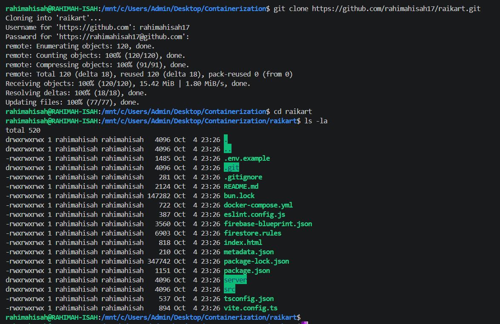

Inspect the project:

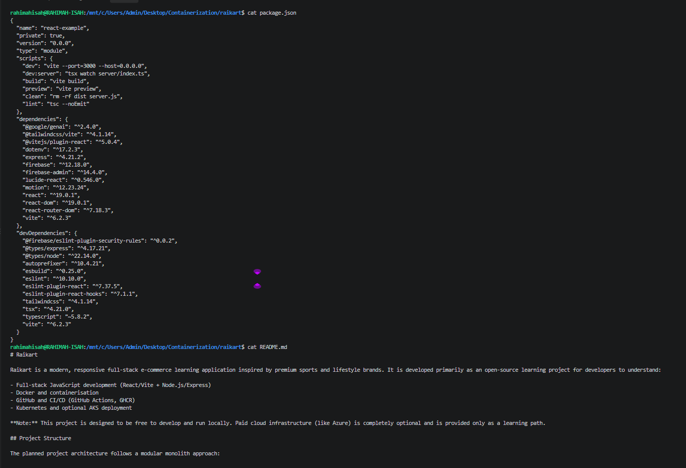

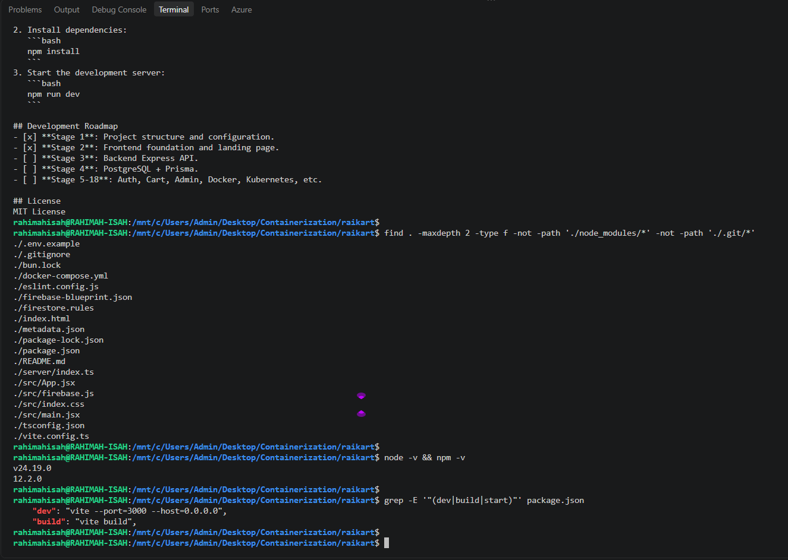

---

# 2. Install Dependencies

Install the project dependencies:

```bash
npm install --legacy-peer-deps --no-audit --no-fund
```

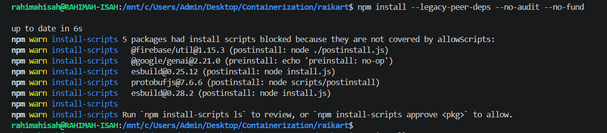

The `--legacy-peer-deps` option allows npm to install the existing dependency tree despite a peer-dependency resolution conflict involving ESLint packages.

---

# 3. Run the Application Locally

Start the Vite development server:

```bash
npm run dev
```

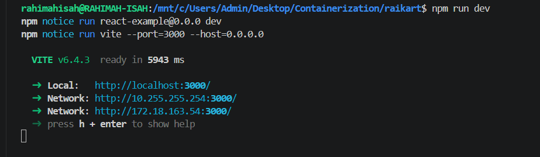

The application runs on:

```text
http://localhost:3000
```

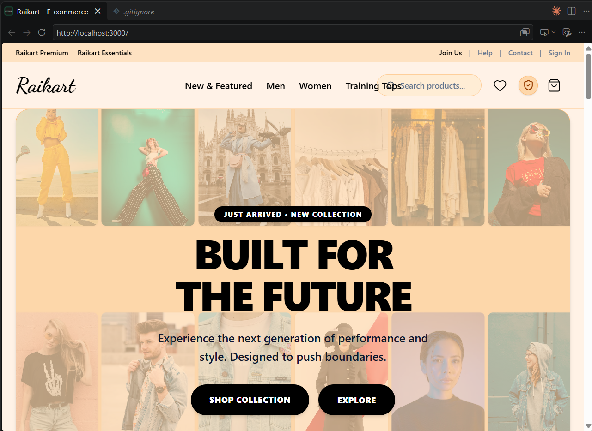

This confirms that the application can run successfully in the local development environment before containerization.

---

# 4. Docker Containerization

## Dockerfile

The application uses a multi-stage Docker build.

The first stage uses Node.js to install dependencies and build the Vite application.

The second stage uses Nginx as the lightweight production runtime.

```dockerfile
FROM node:20-slim AS build

WORKDIR /app

COPY package*.json ./

RUN npm ci --legacy-peer-deps

COPY . .

ARG VITE_ADMIN_EMAILS
ARG VITE_FIREBASE_API_KEY
ARG VITE_FIREBASE_AUTH_DOMAIN
ARG VITE_FIREBASE_PROJECT_ID
ARG VITE_FIREBASE_STORAGE_BUCKET
ARG VITE_FIREBASE_MESSAGING_SENDER_ID
ARG VITE_FIREBASE_APP_ID
ARG VITE_GOOGLE_CLIENT_ID
ARG VITE_PAYSTACK_PUBLIC_KEY

ENV VITE_ADMIN_EMAILS=$VITE_ADMIN_EMAILS
ENV VITE_FIREBASE_API_KEY=$VITE_FIREBASE_API_KEY
ENV VITE_FIREBASE_AUTH_DOMAIN=$VITE_FIREBASE_AUTH_DOMAIN
ENV VITE_FIREBASE_PROJECT_ID=$VITE_FIREBASE_PROJECT_ID
ENV VITE_FIREBASE_STORAGE_BUCKET=$VITE_FIREBASE_STORAGE_BUCKET
ENV VITE_FIREBASE_MESSAGING_SENDER_ID=$VITE_FIREBASE_MESSAGING_SENDER_ID
ENV VITE_FIREBASE_APP_ID=$VITE_FIREBASE_APP_ID
ENV VITE_GOOGLE_CLIENT_ID=$VITE_GOOGLE_CLIENT_ID
ENV VITE_PAYSTACK_PUBLIC_KEY=$VITE_PAYSTACK_PUBLIC_KEY

RUN npm run build

FROM nginx:1.27-alpine

COPY --from=build /app/dist /usr/share/nginx/html

RUN printf 'server {\n\
    listen 3000;\n\
    root /usr/share/nginx/html;\n\
    location / {\n\
        try_files $uri /index.html;\n\
    }\n\
}\n' > /etc/nginx/conf.d/default.conf

EXPOSE 3000
```

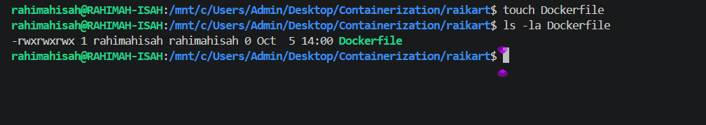

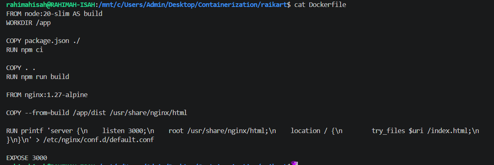

### Why Multi-Stage Builds?

The build environment contains Node.js, npm, dependencies, and the tools required to compile the application.

The production image only needs the generated static files and Nginx.

This provides a cleaner separation:

```text
Build Stage
Node.js
   │
   ├── Install dependencies
   ├── Copy source code
   └── npm run build
          │
          ▼
       dist/
          │
          ▼
Production Stage
Nginx
   │
   └── Serve dist/
```

---

## .dockerignore

The `.dockerignore` file prevents unnecessary files from entering the Docker build context.

```text
node_modules/
.git/
dist/
.env
*.log
```

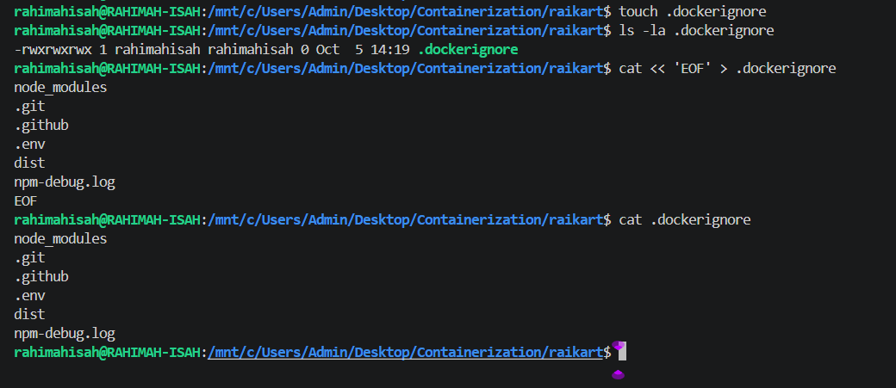

The `.env` file is excluded from the Docker build context.

---

# 5. Build and Test the Docker Image

Build the Docker image:

```bash
docker build \
  --build-arg VITE_ADMIN_EMAILS="$VITE_ADMIN_EMAILS" \
  --build-arg VITE_FIREBASE_API_KEY="$VITE_FIREBASE_API_KEY" \
  --build-arg VITE_FIREBASE_AUTH_DOMAIN="$VITE_FIREBASE_AUTH_DOMAIN" \
  --build-arg VITE_FIREBASE_PROJECT_ID="$VITE_FIREBASE_PROJECT_ID" \
  --build-arg VITE_FIREBASE_STORAGE_BUCKET="$VITE_FIREBASE_STORAGE_BUCKET" \
  --build-arg VITE_FIREBASE_MESSAGING_SENDER_ID="$VITE_FIREBASE_MESSAGING_SENDER_ID" \
  --build-arg VITE_FIREBASE_APP_ID="$VITE_FIREBASE_APP_ID" \
  --build-arg VITE_GOOGLE_CLIENT_ID="$VITE_GOOGLE_CLIENT_ID" \
  --build-arg VITE_PAYSTACK_PUBLIC_KEY="$VITE_PAYSTACK_PUBLIC_KEY" \
  -t raikart:local .
```

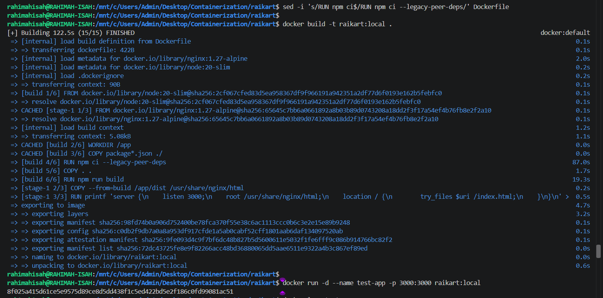

Run the container:

```bash
docker run -d --name raikart -p 3000:3000 raikart:local
```

View the container logs:

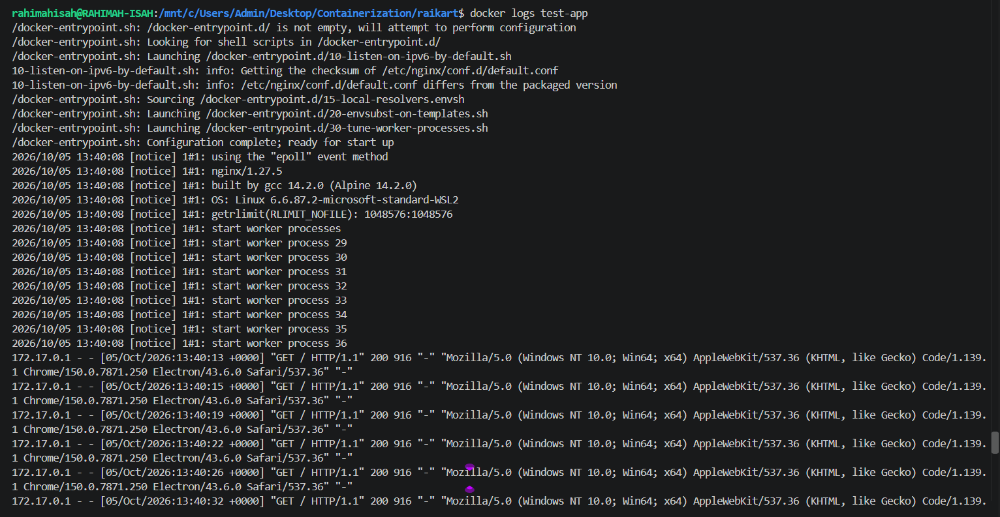

Check the running container:

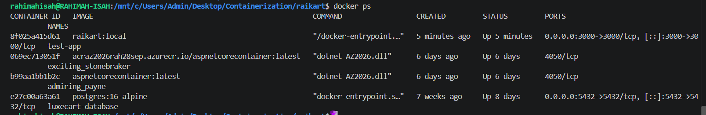

Test the application endpoint:

```bash
curl http://localhost:3000
```

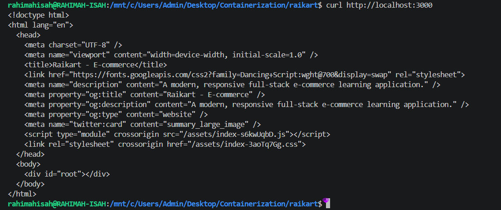

A successful HTTP response confirms that Nginx is serving the compiled application from inside the container.

---

# 6. Push the Source Code to GitHub

After validating the Docker image locally, the project changes were committed and pushed to GitHub.

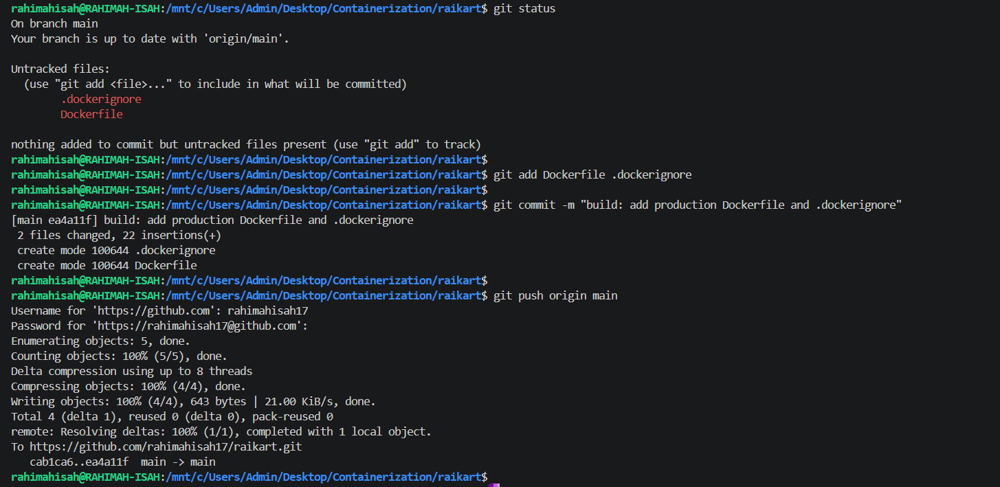

The GitHub repository contains the application source code, Docker configuration, CI/CD workflow, documentation, and deployment evidence.

---

# 7. Azure Container Registry

Azure Container Registry was used as the private container image registry.

## Azure Authentication

Authenticate with Azure:

```bash
az login
```

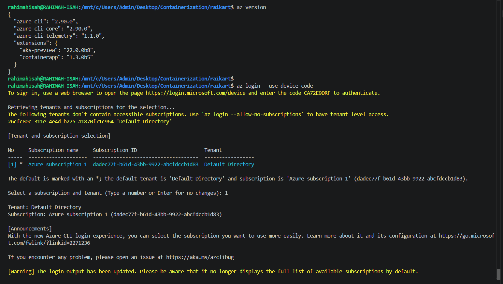

Check the active Azure account and subscription:

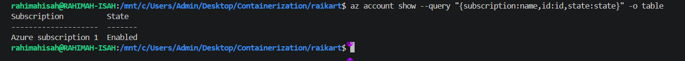

---

## Container Registry

The Azure Container Registry used for the deployment was:

```text
raikartacr8642
```

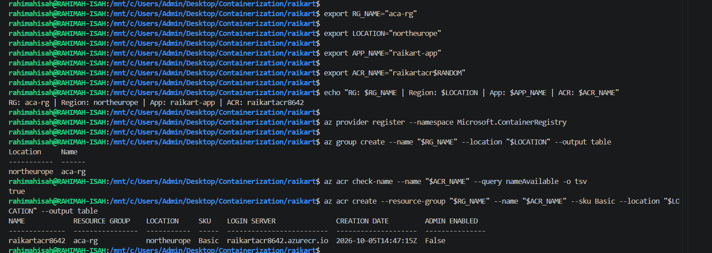

Inspect the registry:

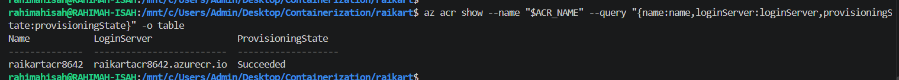

---

## Authenticate Docker with ACR

Authenticate Docker against the registry:

```bash
az acr login --name raikartacr8642
```

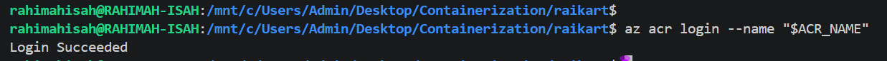

Push the Docker image:

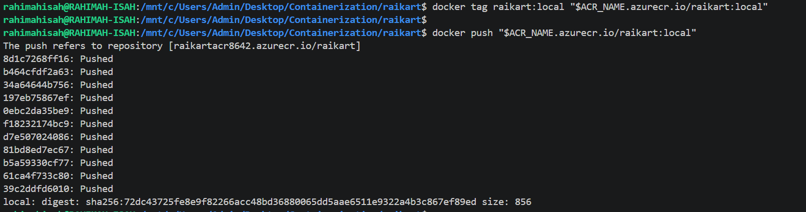

Verify the repository:

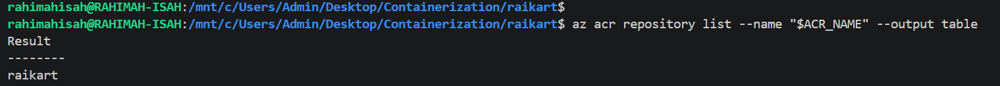

Check the available image tags:

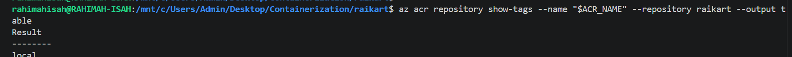

Inspect the image manifest:

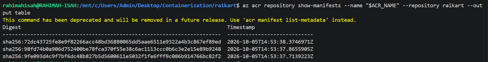

---

# 8. Azure Container Apps

Azure Container Apps provides a managed platform for running containerized applications without directly managing the underlying Kubernetes infrastructure.

## Register the Container Apps Provider

Register the Azure Container Apps provider:

```bash
az provider register --namespace Microsoft.App
```

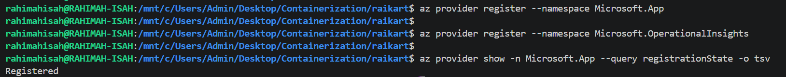

---

## Install the Container Apps Extension

Install or update the Azure Container Apps CLI extension:

```bash
az extension add --name containerapp --upgrade
```

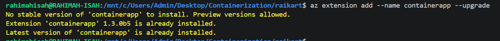

---

## Container Apps Environment

The deployment used an Azure Container Apps environment.

```text
Resource Group: aca-rg
Location: North Europe
Environment: raikart-aca-env
```

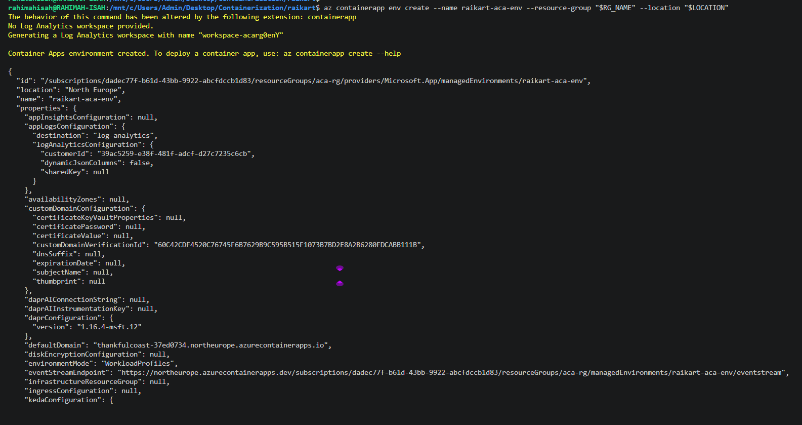

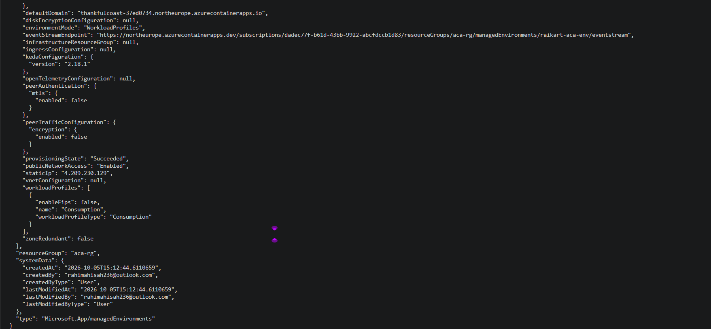

---

## Create the Container App

The Container App was configured with:

```text
Application: raikart-app
Registry: raikartacr8642
Container Port: 3000
Ingress: External
```

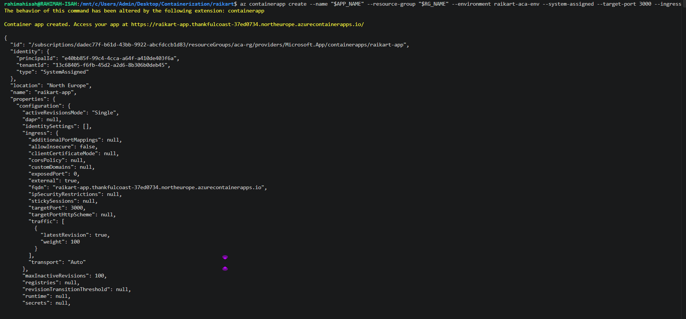

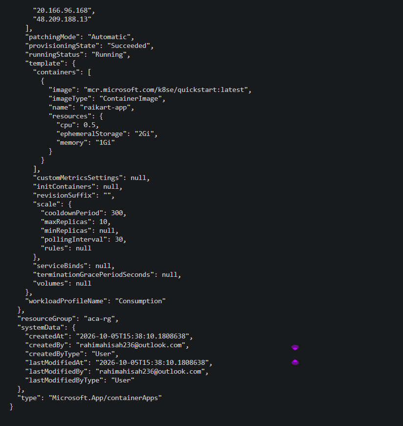

---

## Configure ACR Pull Permissions

The Container App needs permission to pull images from Azure Container Registry.

The Container App's managed identity was granted the:

```text
AcrPull
```

role.

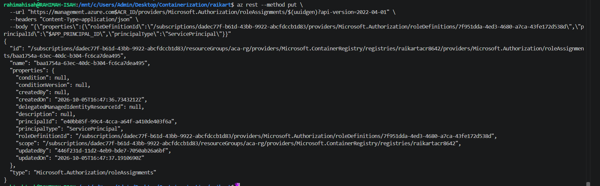

The registry configuration was then verified:

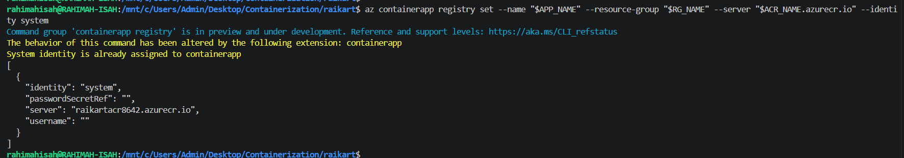

---

## Deploy the Container

The application image was deployed to Azure Container Apps.

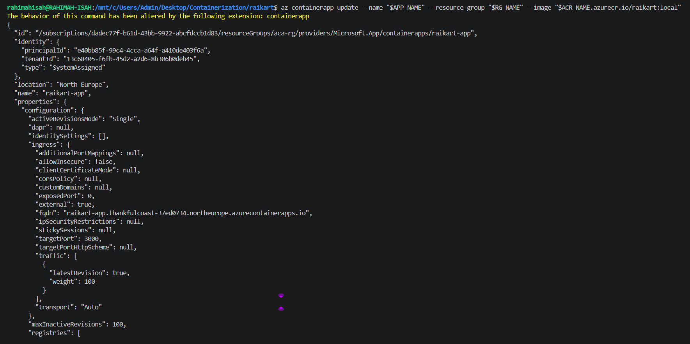

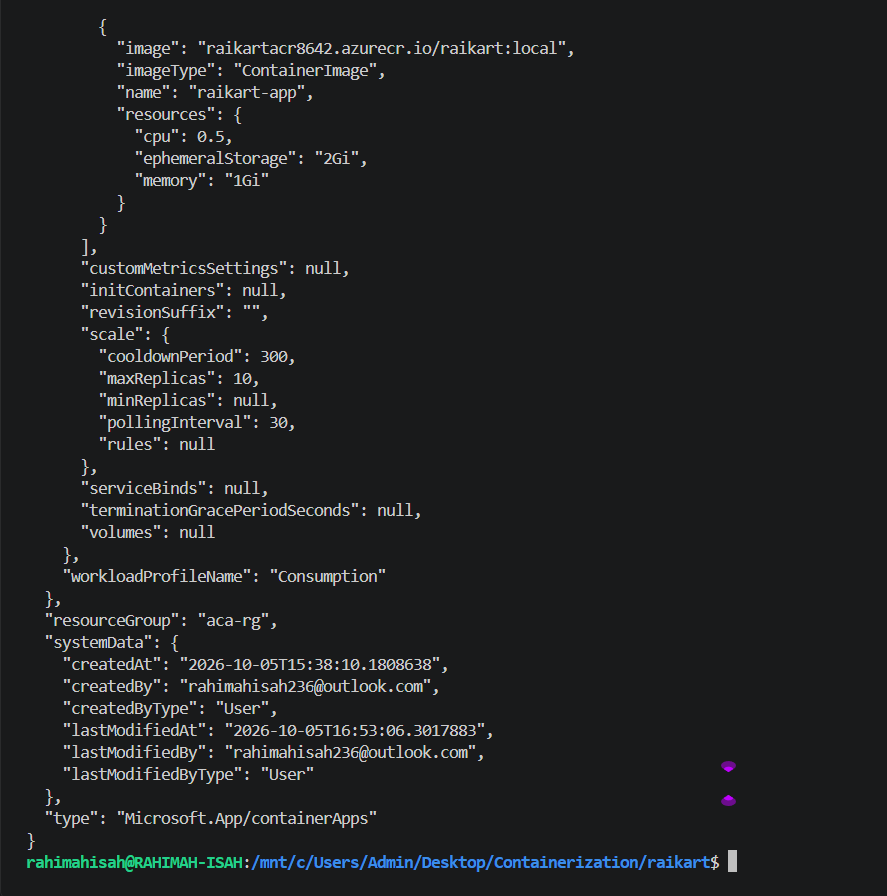

Test the deployed application endpoint:


Open the deployed application:

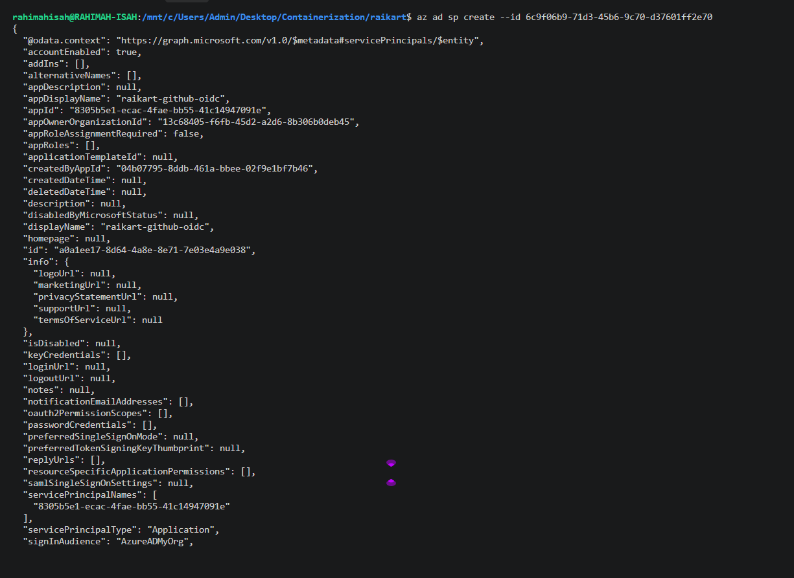

---

# 9. GitHub Actions CI/CD

GitHub Actions automates the application build, container image publishing, and Azure deployment process.

The workflow is located at:

```text
.github/workflows/workflow.yml
```

The pipeline performs the following operations:

```text
Git push to main
       │
       ▼
GitHub Actions
       │
       ▼
Authenticate to Azure using OIDC
       │
       ▼
Login to Azure Container Registry
       │
       ▼
Build Docker image
       │
       ▼
Push image to ACR
       │
       ▼
Update Azure Container App
       │
       ▼
Running application
```

---

## GitHub OIDC Authentication

Microsoft Entra ID was configured with a federated credential that allows GitHub Actions to authenticate to Azure without storing a long-lived Azure client secret.

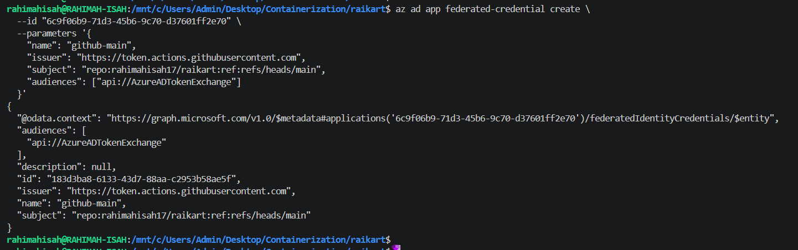

The workflow grants the required GitHub Actions permissions:

```yaml
permissions:
  id-token: write
  contents: read
```

Azure authentication is performed using:

```yaml
- name: Log in to Azure via OIDC
  uses: azure/login@v2
  with:
    client-id: ${{ secrets.AZURE_CLIENT_ID }}
    tenant-id: ${{ secrets.AZURE_TENANT_ID }}
    subscription-id: ${{ secrets.AZURE_SUBSCRIPTION_ID }}
```

---

## Workflow Configuration

The deployment workflow uses GitHub Actions to build and publish the container image and then update Azure Container Apps.

```yaml
name: Build, Push, Deploy to Azure Container Apps

on:
  push:
    branches: [main]
  workflow_dispatch:

permissions:
  id-token: write
  contents: read

jobs:
  build-push-deploy:
    runs-on: ubuntu-latest

    steps:
      - uses: actions/checkout@v4

      - name: Log in to Azure via OIDC
        uses: azure/login@v2
        with:
          client-id: ${{ secrets.AZURE_CLIENT_ID }}
          tenant-id: ${{ secrets.AZURE_TENANT_ID }}
          subscription-id: ${{ secrets.AZURE_SUBSCRIPTION_ID }}

      - name: Install Container Apps extension
        run: az extension add --name containerapp --upgrade

      - name: Log in to ACR
        run: az acr login --name raikartacr8642

      - name: Build and push image
        run: |
          docker build \
            --build-arg VITE_ADMIN_EMAILS="${{ secrets.VITE_ADMIN_EMAILS }}" \
            --build-arg VITE_FIREBASE_API_KEY="${{ secrets.VITE_FIREBASE_API_KEY }}" \
            --build-arg VITE_FIREBASE_AUTH_DOMAIN="${{ secrets.VITE_FIREBASE_AUTH_DOMAIN }}" \
            --build-arg VITE_FIREBASE_PROJECT_ID="${{ secrets.VITE_FIREBASE_PROJECT_ID }}" \
            --build-arg VITE_FIREBASE_STORAGE_BUCKET="${{ secrets.VITE_FIREBASE_STORAGE_BUCKET }}" \
            --build-arg VITE_FIREBASE_MESSAGING_SENDER_ID="${{ secrets.VITE_FIREBASE_MESSAGING_SENDER_ID }}" \
            --build-arg VITE_FIREBASE_APP_ID="${{ secrets.VITE_FIREBASE_APP_ID }}" \
            --build-arg VITE_GOOGLE_CLIENT_ID="${{ secrets.VITE_GOOGLE_CLIENT_ID }}" \
            --build-arg VITE_PAYSTACK_PUBLIC_KEY="${{ secrets.VITE_PAYSTACK_PUBLIC_KEY }}" \
            -t raikartacr8642.azurecr.io/raikart:${{ github.sha }} .

          docker push raikartacr8642.azurecr.io/raikart:${{ github.sha }}

      - name: Deploy to Azure Container Apps
        run: |
          az containerapp update \
            --name raikart-app \
            --resource-group aca-rg \
            --image raikartacr8642.azurecr.io/raikart:${{ github.sha }}
```

The workflow supports both automatic execution on pushes to `main` and manual execution through `workflow_dispatch`.

---

## Successful Pipeline

The GitHub Actions workflow successfully completed the build, push, and deployment process.

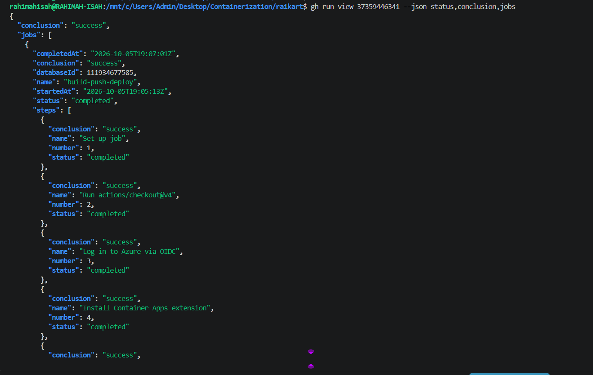

---

# 10. Deployment Verification

The deployed Container App revision was verified after the CI/CD pipeline completed.

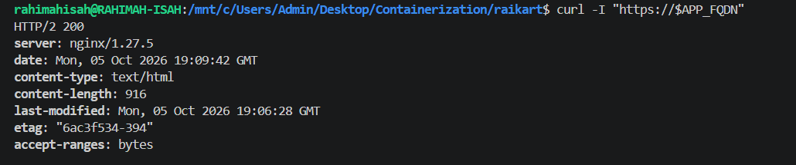

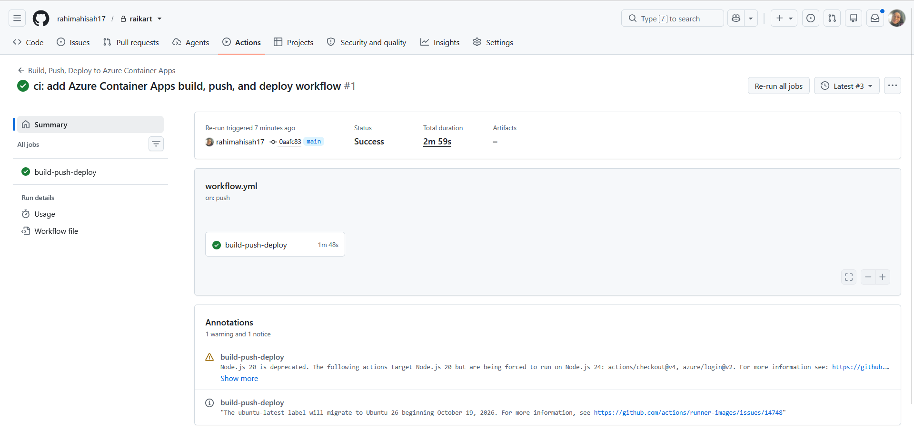

The final application was also verified through the browser:

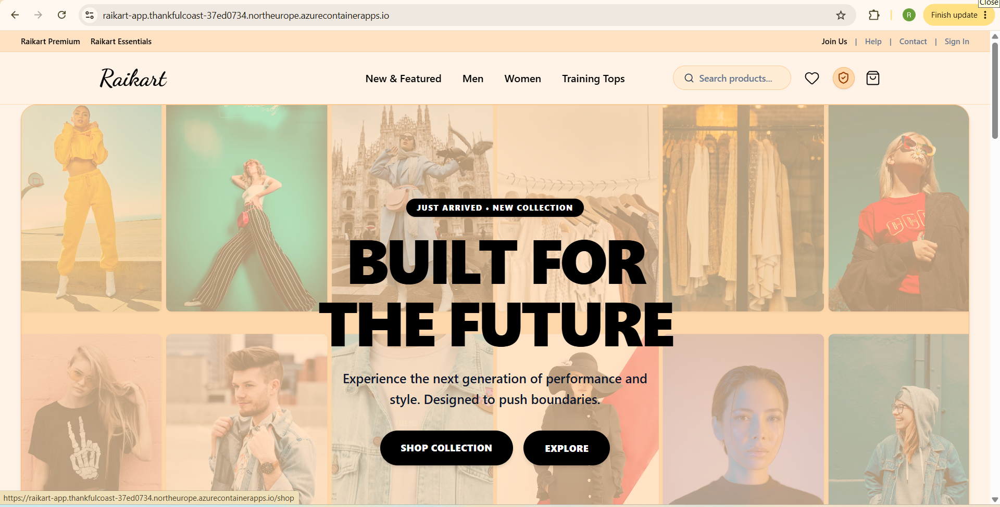

The deployment verification confirmed that:

- The Docker image was available in Azure Container Registry.
- Azure Container Apps successfully pulled the image.
- The container started successfully.
- Nginx served the compiled application.
- External ingress was accessible.
- The application returned a successful HTTP response.
- The application was accessible through the Azure Container Apps endpoint.

---

# 11. Cleanup

After completing the deployment, the Azure resources were removed.

The resource group was deleted with:

```bash
az group delete --name aca-rg --yes --no-wait
```

The Microsoft Entra application registration used for GitHub OIDC authentication was also removed.

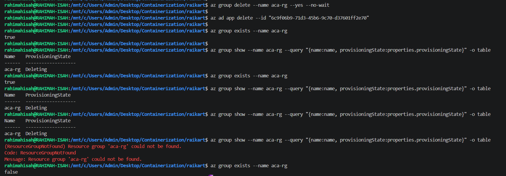

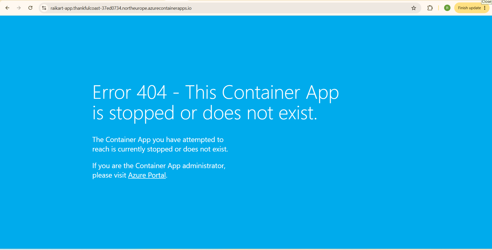

The final cleanup verification confirmed that the Container App was stopped or no longer existed.

This cleanup prevents unnecessary Azure resources from continuing to consume resources after the deployment exercise.

---

# Troubleshooting

## npm Dependency Resolution Error

The project encountered an npm peer-dependency resolution conflict involving ESLint packages.

The installation was completed successfully using:

```bash
npm install --legacy-peer-deps --no-audit --no-fund
```

---

## Firebase Configuration Error

During the first production deployment, the application displayed a Firebase configuration error.

The issue occurred because Vite environment variables are resolved during the frontend build process.

The solution was to provide the required `VITE_*` configuration values as Docker build arguments and make them available during the `npm run build` step.

The resulting values are embedded into the compiled frontend application as expected for Vite client-side configuration.

---

## Docker Build Warnings

Docker reported warnings concerning sensitive-looking values passed through `ARG` and `ENV`.

Vite frontend configuration is different from server-side secrets because values beginning with `VITE_` are intentionally exposed to the browser and become part of the generated frontend bundle.

However, genuine server-side secrets must never be included in frontend environment variables.

Examples of values that must remain server-side include:

- Private API keys
- Database passwords
- Service account credentials
- Private certificates
- Access tokens
- Signing secrets

---

## Azure Container Registry Pull Permission

The Azure Container App initially required explicit permission to pull the private image from Azure Container Registry.

The Container App's managed identity was assigned:

```text
AcrPull
```

This allowed the Container App to authenticate against the registry and retrieve the image.

---

## GitHub Actions OIDC Authentication

GitHub Actions authentication required a Microsoft Entra federated credential.

The credential must match the GitHub repository and branch identity used by the workflow.

Once the federated credential and Azure role permissions were correctly configured, GitHub Actions was able to authenticate successfully.

---

## Container Image Tags

The deployment workflow uses the GitHub commit SHA as the Docker image tag:

```text
raikart:<github-sha>
```

Using a commit SHA provides an immutable reference to the source revision associated with a deployment.

This is preferable to relying exclusively on mutable tags such as:

```text
raikart:latest
```

because a commit-based tag makes it easier to identify exactly which version was deployed.

---

# Security Considerations

## Frontend Environment Variables

Variables prefixed with `VITE_` are intended for frontend applications and are embedded into the generated JavaScript bundle.

They should therefore never contain true server-side secrets.

Firebase web configuration can safely contain values intended for client-side initialization when the Firebase project is correctly protected with authentication, authorization rules, and other platform controls.

---

## GitHub Secrets

Deployment configuration values are supplied through GitHub Actions Secrets rather than being hard-coded into the repository.

The workflow references secrets using:

```yaml
${{ secrets.SECRET_NAME }}
```

Actual secret values are not stored in the source code.

---

## OIDC Instead of Long-Lived Credentials

GitHub Actions uses OpenID Connect authentication with Microsoft Entra ID.

This avoids storing a long-lived Azure client secret for the deployment workflow.

The authentication flow is:

```text
GitHub Actions
      │
      │ OIDC token
      ▼
Microsoft Entra ID
      │
      │ Federated trust
      ▼
Azure
```

---

# Key DevOps Concepts Demonstrated

## Containerization

The application is packaged into a portable Docker image that can run consistently across environments.

## Multi-Stage Docker Builds

The Dockerfile separates application compilation from production serving.

```text
Node.js Build Image
        │
        │ npm run build
        ▼
      dist/
        │
        ▼
Nginx Runtime Image
```

## Container Registry

Azure Container Registry provides private storage for the Docker images used by the deployment.

## Managed Identity

Azure Container Apps uses a managed identity to authenticate against Azure Container Registry.

## Continuous Integration

GitHub Actions automatically builds the application and Docker image when changes are pushed to the configured branch.

## Continuous Deployment

After the image is built and pushed, the workflow updates the Azure Container App with the new image.

## OpenID Connect

GitHub Actions authenticates to Azure through Microsoft Entra federated identity rather than requiring a long-lived client secret.

## Immutable Image Versioning

The GitHub commit SHA is used as the container image tag.

This makes deployments traceable back to a specific source revision.

## Production Web Serving

Nginx serves the compiled Vite application as a production-ready static web application.

## Cloud Resource Lifecycle

The project demonstrates not only deployment but also resource cleanup after the deployment is complete.

---

# Future Improvements

Potential improvements include:

- Add automated application tests to the CI pipeline.
- Add Docker image vulnerability scanning.
- Add dependency vulnerability scanning.
- Add automated rollback support.
- Add Azure Monitor and Log Analytics integration.
- Add health probes and readiness checks.
- Add separate staging and production environments.
- Add infrastructure as code using Bicep or Terraform.
- Add deployment approval gates.
- Add automated browser testing with Playwright.
- Add container image retention policies in ACR.
- Add a custom domain and HTTPS configuration.
- Add monitoring and alerting for production workloads.

---

# License

This project is licensed under the MIT License.

See the [LICENSE](LICENSE) file for the complete license text.

## MIT License

Copyright (c) 2026 Rahimah Sulayman

Permission is hereby granted, free of charge, to any person obtaining a copy
of this software and associated documentation files (the "Software"), to deal
in the Software without restriction, including without limitation the rights
to use, copy, modify, merge, publish, distribute, sublicense, and/or sell
copies of the Software, and to permit persons to whom the Software is
furnished to do so, subject to the following conditions:

The above copyright notice and this permission notice shall be included in all
copies or substantial portions of the Software.

THE SOFTWARE IS PROVIDED "AS IS", WITHOUT WARRANTY OF ANY KIND, EXPRESS OR
IMPLIED, INCLUDING BUT NOT LIMITED TO THE WARRANTIES OF MERCHANTABILITY,
FITNESS FOR A PARTICULAR PURPOSE AND NONINFRINGEMENT. IN NO EVENT SHALL THE
AUTHORS OR COPYRIGHT HOLDERS BE LIABLE FOR ANY CLAIM, DAMAGES OR OTHER
LIABILITY, WHETHER IN AN ACTION OF CONTRACT, TORT OR OTHERWISE, ARISING FROM,
OUT OF OR IN CONNECTION WITH THE SOFTWARE OR THE USE OR OTHER DEALINGS IN THE
SOFTWARE.

---

## Project Highlights

This project demonstrates a complete modern container deployment workflow:

```text
Local Development
       │
       ▼
React + Vite
       │
       ▼
Docker
       │
       ▼
Nginx
       │
       ▼
Azure Container Registry
       │
       ▼
Azure Container Apps
       │
       ▲
       │
GitHub Actions
       ▲
       │
Microsoft Entra OIDC
```

The result is a repeatable cloud deployment workflow combining application development, Docker containerization, Azure cloud services, identity management, and automated CI/CD.
